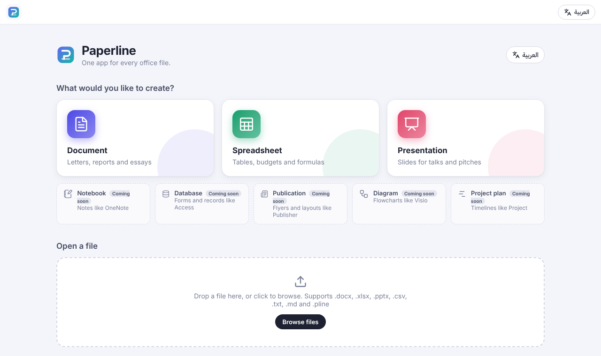
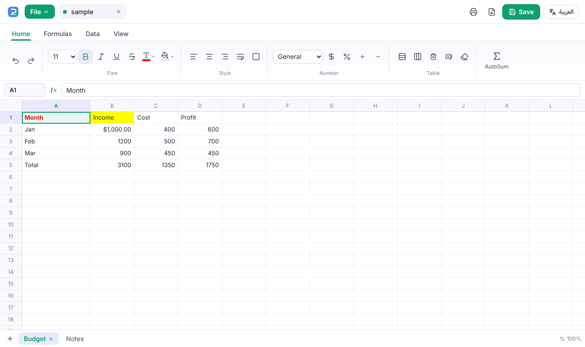
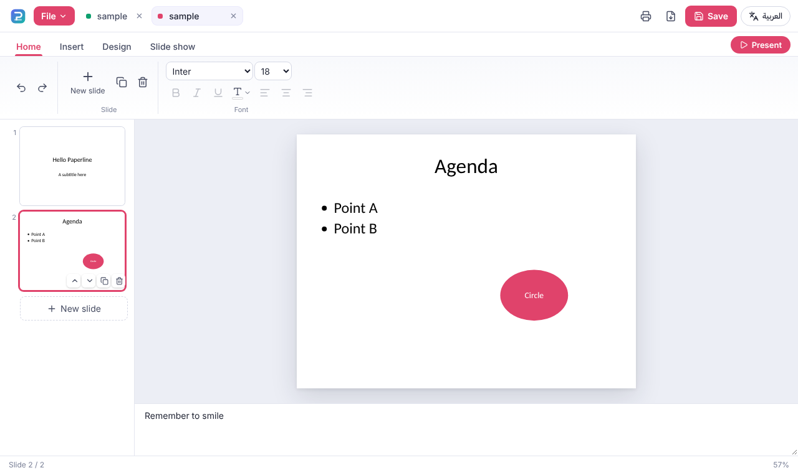

# Paperline

Paperline is one app for every office file. It opens, edits and creates Word, Excel and PowerPoint files, has its own `.pline` format, exports PDF and prints, all on your own device. The interface is in English with an Arabic (right-to-left) option.

> Status: **Phase 1, web app.** Desktop (Windows, macOS) and mobile (iOS, Android) builds come next from the same code. See [ROADMAP.md](ROADMAP.md).



## What works today

| | Documents | Spreadsheets | Presentations | PDF |
|---|---|---|---|---|
| Create new | ✓ (blank and templates) | ✓ (blank and templates) | ✓ (layouts and templates) | ✓ (blank pages, or from pictures) |
| Open | `.docx`, `.txt`, `.md`, `.html` | `.xlsx`, `.csv`, `.tsv` | `.pptx` | `.pdf` |
| Save as Office | `.docx` | `.xlsx`, `.csv` | `.pptx` | `.pdf` |
| Native format | `.pline` | `.pline` | `.pline` | `.pdf` |
| PDF export and print | ✓ | ✓ | ✓ (one slide per page) | ✓ |

**New file picker.** The start screen asks what you want to make, and the ribbon changes to fit the file type.

**Fonts.** Every font picker lists the fonts installed on the device (through the Local Font Access API where the browser has it, and a font probe elsewhere), next to Paperline's own fonts and recently used ones.

**Documents:** fonts and sizes, grow and shrink, change case, subscript and superscript, colors and highlight, a style gallery, bullet, numbered and check lists, indent, line and paragraph spacing, format painter, alignment and text direction, tables, pictures, links, symbols, date and time, page breaks, headers and footers with page numbers, a table of contents, find and replace, page size, margins, orientation and page color, read aloud, a navigation pane and a word count.

**Spreadsheets:** a fast grid with keyboard navigation, a formula bar and about 100 functions; number formats including time, scientific and text; merged cells, borders per side, vertical alignment; a fill handle that continues numbers, dates, weekdays, months and quarters (English and Arabic); filters, sort, remove duplicates and dropdown lists; conditional formatting (highlight rules, top and bottom, data bars, color scales); "format as table"; charts (column, bar, line, area, pie, doughnut, scatter); cell notes; find and replace; hide, unhide and autofit rows and columns; show formulas; and a context menu. Merges, borders, notes, lists, filters and conditional formatting round-trip through `.xlsx`.

**Presentations:** a gallery of 27 shapes, text boxes, pictures, tables and charts; multi-select with a selection box, smart guides while dragging, a rotation handle, align and distribute, bring forward and send backward, flip, opacity, shadow, outline width and dash; bullets and numbering, line spacing, strike, grow and shrink; copy and paste, including pictures and text from other apps; slide transitions (fade, push, wipe, zoom, cover); hidden slides; slide size (16:9, 4:3, 16:10, A4); slide numbers and a footer; drag to reorder slides; six themes; speaker notes; and a slide show with a presenter view (current and next slide, notes, timer, black screen). Tables, charts, transitions and hidden slides round-trip through `.pptx`.

**PDF:** view, search and zoom; add text, shapes, ink, notes, stamps and signatures; edit existing text; fill forms; redact; reorder, rotate, delete, extract, split and merge pages; turn pictures into a PDF; and save a real PDF.

**Arabic.** The language button switches the whole interface to Arabic and mirrors the layout. Text you type picks its own direction, so Arabic and English can be mixed in one file.

| Spreadsheet | Presentation | Arabic interface |
|---|---|---|
|  |  |  |

## Running it

```bash
npm install
npm run dev      # http://localhost:5173
npm test         # formula engine tests
npm run build    # production build in dist/
```

## How it is built

- **React 19 + TypeScript + Vite** for the app.
- **Documents:** [TipTap](https://tiptap.dev) (ProseMirror). `.docx` is read with `mammoth` and written with `docx`.
- **Spreadsheets:** Paperline's own grid and formula engine (`src/editors/sheet/formula.ts`). `.xlsx` is read and written with `exceljs`; formulas are saved with their results so other apps show values right away.
- **Presentations:** Paperline's own slide canvas. `.pptx` is written with `pptxgenjs` and read by Paperline's own parser (`src/editors/slides/pptxIO.ts`), which follows layout and master placeholders, theme colors and fonts, pictures and notes.
- **PDF:** each page is drawn with `html2canvas-pro` and placed with `jsPDF`. Pages break between paragraphs and table rows, never through a line.
- **`.pline` files** are a zip holding `manifest.json` (format, version and file kind) and `content.json` (the document model). The format is versioned so later versions can still open today's files.
- **Icons:** [Lucide](https://lucide.dev). The logo and the rest of the look are Paperline's own.

```
src/
  App.tsx              app shell, file tabs, File menu, shortcuts
  StartScreen.tsx      the "what would you like to create?" picker
  i18n.tsx             English and Arabic strings, direction switch
  ui/Ribbon.tsx        ribbon, groups, buttons, color picker, menus
  editors/doc/         document editor and .docx conversion
  editors/sheet/       grid, formula engine, .xlsx and .csv conversion
  editors/slides/      slide editor, presenter, .pptx conversion
  io/files.ts          open, save and the .pline format
  io/print.tsx         print and PDF export
```

## Keyboard shortcuts

| | |
|---|---|
| Ctrl/⌘ + S | Save as the Office format (`.docx`, `.xlsx`, `.pptx`) |
| Ctrl/⌘ + Shift + S | Save as `.pline` |
| Ctrl/⌘ + O | Open |
| Ctrl/⌘ + P | Print |
| Ctrl/⌘ + Z / Y | Undo / redo |
| F2 | Edit the active cell |
| F5 / Shift + F5 | Present from the start / from the current slide |
| Ctrl/⌘ + A, C, X, V, D | Select all, copy, cut, paste, duplicate (slides) |
| Ctrl/⌘ + [ / ] | Send backward / bring forward (add Shift for back / front) |
| Ctrl/⌘ + M | New slide |
| B, Shift + P | In a slide show: black screen, presenter view |
