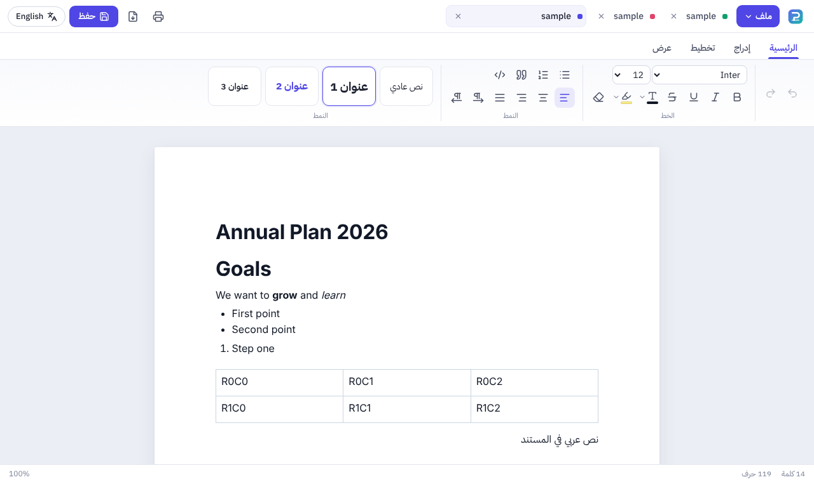

# Paperline

Paperline is one app for every office file. It opens, edits and creates Word, Excel and PowerPoint files, has its own `.pline` format, exports PDF and prints, all on your own device. The interface is in English with an Arabic (right-to-left) option.

> Status: **Phase 1, web app.** Desktop (Windows, macOS) and mobile (iOS, Android) builds come next from the same code. See [ROADMAP.md](ROADMAP.md).


## What works today

| | Documents | Spreadsheets | Presentations |
|---|---|---|---|
| Create new | ✓ | ✓ | ✓ (title, content, two-column, blank layouts) |
| Open | `.docx`, `.txt`, `.md`, `.html` | `.xlsx`, `.csv`, `.tsv` | `.pptx` |
| Save as Office | `.docx` | `.xlsx`, `.csv` | `.pptx` |
| Native format | `.pline` | `.pline` | `.pline` |
| PDF export and print | ✓ | ✓ | ✓ (one slide per page) |

**New file picker.** The start screen asks what you want to make, and the ribbon changes to fit: Home, Insert, Layout and View for documents; Home, Formulas, Data and View for spreadsheets; Home, Insert, Design and Slide show for presentations.

**Documents:** fonts and sizes, bold, italic, underline, strike, text color and highlight, headings and a style gallery, bullet and numbered lists, quotes, code blocks, alignment, per-paragraph left-to-right or right-to-left, tables (add or remove rows and columns, resize), pictures, links, dividers, page breaks, portrait or landscape, margins, zoom, and a word count.

**Spreadsheets:** a fast grid with keyboard navigation, a formula bar, point-and-click references while typing a formula, 47 functions (`SUM`, `AVERAGE`, `IF`, `VLOOKUP`, `INDEX`/`MATCH`, `SUMIF`, `COUNTIF`, `TEXT`, dates and more), references across sheets, number formats (number, currency, percent, date, decimals), cell styles, borders, wrap, column resize, insert and delete rows or columns with formulas kept correct, sort, freeze the top row, copy and paste that keeps formulas, multiple sheets, and sum, average and count of the selection in the status bar.

**Presentations:** a slide rail with reorder, duplicate and delete; text boxes and shapes (rectangle, rounded, ellipse, triangle, arrow, line); pictures; drag, resize and snap to center; fonts, colors and alignment; bullets with two levels; six themes; slide backgrounds; speaker notes; and a full-screen presenter.

**Arabic.** The language button switches the whole interface to Arabic and mirrors the layout. Text you type picks its own direction, so Arabic and English can be mixed in one file.

| Spreadsheet | Presentation | Arabic interface |
|---|---|---|
|  |  |  |

## Running it

```bash
npm install
npm run dev      # http://localhost:5173
npm test         # formula engine tests
npm run build    # production build in dist/
```

## How it is built

- **React 19 + TypeScript + Vite** for the app.
- **Documents:** [TipTap](https://tiptap.dev) (ProseMirror). `.docx` is read with `mammoth` and written with `docx`.
- **Spreadsheets:** Paperline's own grid and formula engine (`src/editors/sheet/formula.ts`). `.xlsx` is read and written with `exceljs`; formulas are saved with their results so other apps show values right away.
- **Presentations:** Paperline's own slide canvas. `.pptx` is written with `pptxgenjs` and read by Paperline's own parser (`src/editors/slides/pptxIO.ts`), which follows layout and master placeholders, theme colors and fonts, pictures and notes.
- **PDF:** each page is drawn with `html2canvas-pro` and placed with `jsPDF`. Pages break between paragraphs and table rows, never through a line.
- **`.pline` files** are a zip holding `manifest.json` (format, version and file kind) and `content.json` (the document model). The format is versioned so later versions can still open today's files.
- **Icons:** [Lucide](https://lucide.dev). The logo and the rest of the look are Paperline's own.

```
src/
  App.tsx              app shell, file tabs, File menu, shortcuts
  StartScreen.tsx      the "what would you like to create?" picker
  i18n.tsx             English and Arabic strings, direction switch
  ui/Ribbon.tsx        ribbon, groups, buttons, color picker, menus
  editors/doc/         document editor and .docx conversion
  editors/sheet/       grid, formula engine, .xlsx and .csv conversion
  editors/slides/      slide editor, presenter, .pptx conversion
  io/files.ts          open, save and the .pline format
  io/print.tsx         print and PDF export
```

## Keyboard shortcuts

| | |
|---|---|
| Ctrl/⌘ + S | Save as the Office format (`.docx`, `.xlsx`, `.pptx`) |
| Ctrl/⌘ + Shift + S | Save as `.pline` |
| Ctrl/⌘ + O | Open |
| Ctrl/⌘ + P | Print |
| Ctrl/⌘ + Z / Y | Undo / redo |
| F2 | Edit the active cell |
| F5 / Shift + F5 | Present from the start / from the current slide |
